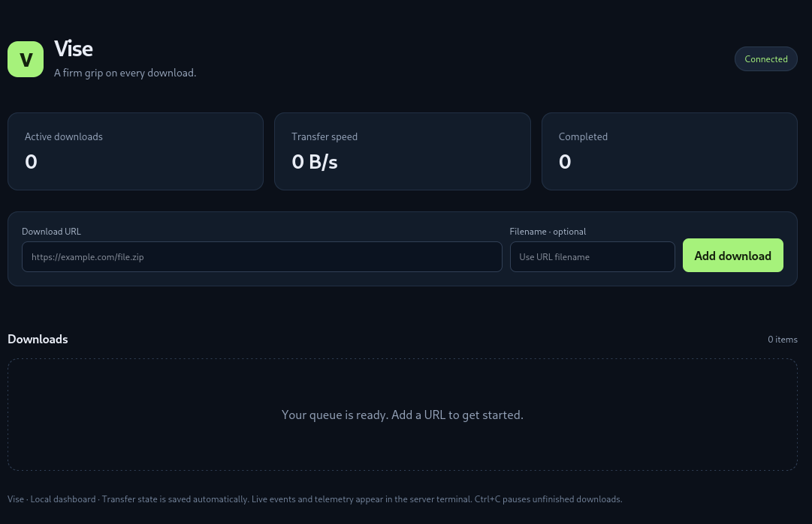

<p align="center">
  
</p>

# Vise

**A firm grip on every download.**

Vise is a high-performance HTTP(S) download manager built in Rust. Multi-threaded chunked downloads run on Tokio's async runtime, while Indicatif keeps the CLI clear with live progress, speed, and ETA. Prefer a dashboard? Launch the lightweight, embedded Axum WebUI with `--webui`.

## Features

- **Parallel transfers:** Split eligible files into chunks and download them concurrently, with configurable connection and queue limits.
- **Clear progress:** Track downloaded bytes, percentage, transfer speed, and ETA in the terminal.
- **Pause, resume, recover:** Control individual tasks and restore saved progress after restarting.
- **Resilient downloads:** Retry dropped connections and transient HTTP failures with bounded backoff.
- **CLI first:** Download from arguments or manage an interactive queue. The web server starts only with `--webui`.
- **Embedded WebUI:** Add URLs, monitor transfers, pause or resume tasks, and delete queue entries through a local dashboard with live WebSocket updates.
- **Live terminal monitor:** In WebUI mode, follow timestamped events and one-second transfer summaries on stdout while the browser controls downloads.
- **Careful file handling:** Validate range responses, save durable checkpoints, and refuse to overwrite existing output files.

## Installation

### Requirements

Install a Rust toolchain with Cargo. Vise declares Rust **1.85 or newer** as its minimum version. Git is also required to clone the repository.

### From a cloned repository

```sh
git clone https://github.com/juic3b0x/vise.git
cd vise
cargo install --path .
```

### Directly from GitHub

```sh
cargo install --git https://github.com/juic3b0x/vise.git
```

For a reproducible build using the repository's `Cargo.lock`, append `--locked` to either installation command:

```sh
cargo install --path . --locked
cargo install --git https://github.com/juic3b0x/vise.git --locked
```

By default, Cargo places the executable in `~/.cargo/bin/` (`%USERPROFILE%\.cargo\bin\` on Windows). Ensure that directory is on your `PATH` to run `vise` instantly from any terminal. Custom Cargo installation roots change this location; see the [Cargo installation reference](https://doc.rust-lang.org/cargo/commands/cargo-install.html).

Confirm the installation:

```sh
vise --version
vise --help
```

Local source installation and Git-source installation have been verified in isolated installation directories. The Git check used a local repository; installation from the live GitHub repository has not yet been verified.

## Quick start

### Download one file

```sh
vise https://example.com/archive.zip
```

### Download a batch

```sh
vise --batch https://example.com/a.zip https://example.com/b.zip
```

URL arguments run until the queue settles. `--batch` explicitly disables terminal input.

### Set the maximum connections

```sh
vise -c 8 https://example.com/large.iso
```

`-c` sets the maximum parallel connections **per download**. Use `-j` to limit simultaneous downloads:

```sh
vise -j 3 -c 8 https://example.com/a.zip https://example.com/b.zip
```

### Choose the output directory and filename

```sh
vise -o ./downloads https://example.com/archive.zip
vise -o ./downloads -n release.zip https://example.com/archive.zip
```

`-o` selects an output directory, which defaults to `downloads`. `-n` sets a filename for exactly one URL.

## Interactive mode

Run `vise` without arguments in a terminal to open the interactive queue:

```sh
vise
```

To queue initial URLs and keep the command loop open:

```sh
vise --interactive https://example.com/large.iso
```

Inside the queue, paste a URL or use these commands:

```text
add https://example.com/archive.zip
add https://example.com/archive.zip custom-name.zip
list
pause 9ac2
resume 9ac2
retry 9ac2
help
quit
```

Task IDs accept a unique prefix of at least four characters. Use `list` to find them. `retry` resumes a failed task after checking the remote resource again.

`quit`, Ctrl+C, and SIGTERM stop active transfers and save partial progress. Resume saved paused or failed tasks using the same output directory:

```sh
vise -o ./downloads --resume-all
```

Parallel range downloads require server range support and a strong ETag or Last-Modified validator. If either is unavailable, Vise uses a single streaming request and restarts that transfer when resumed. Unknown-length streams are supported.

## WebUI

Launch the embedded dashboard:

```sh
vise --webui
```

Or set the loopback address explicitly:

```sh
vise --webui --bind 127.0.0.1:8080
```

Open **[http://127.0.0.1:8080](http://127.0.0.1:8080)** in your browser. Use the exact numeric loopback address printed by Vise.

The dashboard lets you add URLs, inspect progress and transfer speed, and pause, resume, retry, or delete individual downloads. Delete removes the queue entry and partial data; completed output files are kept. It is served directly from the executable: no Node.js, frontend build, external assets, or separate server is required.

You can also seed the queue or restore saved tasks at startup:

```sh
vise --webui https://example.com/large.iso
vise --webui -o ./downloads --resume-all
```

WebUI mode uses the same download engine and worker pool as the CLI, and replaces the interactive terminal loop with a live stdout monitor. It immediately logs actions, state changes, retries, failures, and completions with UTC timestamps, then reports active progress, speed, and ETA every second. Terminal output is colorized when stdout is a terminal; redirected output is plain text, and `NO_COLOR` disables color. The server accepts loopback addresses only and checks browser origins. Remote access can use an authenticated SSH tunnel.

## Showcase

### CLI


### WebUI




## Options at a glance

| Option | Purpose | Default |
| --- | --- | --- |
| `-c, --connections` | Maximum connections per download, 1–64 | `8` |
| `-j, --jobs` | Simultaneous downloads, 1–64 | `3` |
| `-o, --output` | Output directory | `downloads` |
| `-n, --name` | Filename for one URL | Derived from URL |
| `--retries` | Retries per segment, 0–20 | `5` |
| `--timeout` | Idle read timeout in seconds | `30` |
| `-i, --interactive` | Keep the terminal queue open | Off with URL arguments |
| `--batch` | Never read terminal input | Off |
| `--resume-all` | Resume saved paused and failed tasks | Off |
| `--webui` | Start the embedded dashboard | Off |
| `--bind` | WebUI loopback address | `127.0.0.1:8080` |

Run `vise --help` for the full command reference. Set `RUST_LOG=vise=info` for diagnostic logs.

## Tech stack

| Crate | Role |
| --- | --- |
| [Tokio](https://docs.rs/tokio/) | Async execution on a multithreaded runtime |
| [Reqwest](https://docs.rs/reqwest/) | HTTP(S), streaming responses, and range requests |
| [Axum](https://docs.rs/axum/) | Optional local HTTP server, REST API, and WebSockets |
| [Indicatif](https://docs.rs/indicatif/) | Terminal progress bars and transfer monitoring |
| [Clap](https://docs.rs/clap/) | Argument parsing and CLI help |

See [architecture, recovery behavior, and API documentation](docs/architecture.md) for implementation details.

## Development

```sh
cargo build --release --locked
cargo fmt --check
cargo clippy --all-targets --locked -- -D warnings
cargo test --all-targets --locked
```

The test suite exercises parallel transfers, connection limits, retries, pause/resume, abrupt process recovery, safe output handling, CLI behavior, and REST/WebSocket controls using local HTTP fixtures.

## License

Vise is open source, dual-licensed under **MIT / Apache-2.0**. You may use it under either the [MIT license](LICENSE) or the [Apache License 2.0](LICENSE-APACHE), at your option.
