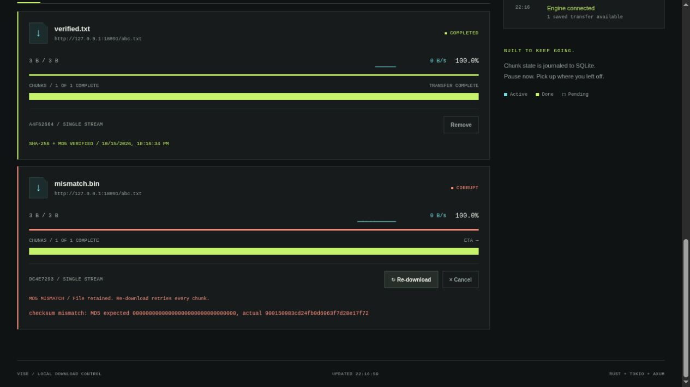

# WebUI

Vise's embedded dashboard presents live transfer telemetry and queue controls in a responsive dark interface with a queue-first layout, subtle surfaces, and readable typography. HTML, CSS, and vanilla JavaScript ship inside the executable; no frontend server, npm install, or asset CDN is needed.

## Launch the dashboard

```sh
vise --webui
```

Or choose the loopback address explicitly:

```sh
vise --webui --bind 127.0.0.1:8080
```

Open [http://127.0.0.1:8080](http://127.0.0.1:8080) in a browser. Use the exact numeric address and port printed by Vise. This local mode binds only to loopback and keeps a live telemetry monitor in the terminal; the browser is the primary controller. It does not automatically open a browser.

For a persistent service or the browser extension, use the [authenticated daemon](daemon.md) instead. It serves the same dashboard, prompts for HTTP Basic credentials (`vise` and your generated token), and omits the terminal monitor. Do not start a second engine if a daemon already owns your global journal.

{ loading=lazy }

The preview above uses sample transfers to illustrate bulk input and live queue controls.

## Live telemetry

- **Aggregate speed:** A rolling 60-second graph shows the combined download rate, with current and peak values.
- **Per-download telemetry:** Queue rows display real byte counts, percentages when total size is known, speed, ETA, and individual sparklines.
- **Chunk grids:** Expand a row's **Chunks** disclosure to inspect its grid. Every cell represents an actual engine chunk and its progress. Active, completed, and pending segments have distinct visual states.
- **Connection and queue counters:** Follow active workers and transfer categories without estimating progress from a page timer.
- **Connection health:** A status indicator reports streaming or fallback/reconnection behavior.

The page consumes `/ws/telemetry` and falls back to `/api/telemetry` polling every two seconds when the stream is unavailable. Graph history belongs to the current page session; it is not a persisted time-series database. Durable task history comes from SQLite and reappears after restarting Vise.

Range-ineligible downloads can legitimately show a single chunk. Unknown-length transfers have byte/speed telemetry without a reliable percentage or ETA until enough information is available. See [chunking and validators](architecture.md#transfers-and-recovery).

## Queue and task controls

Paste one or more HTTP(S) URLs in **Source URLs**, or choose/drop one `.txt` file into the upload area. Files are decoded and parsed locally; only the URL list is sent as JSON after selecting **Add transfers**. Blank lines and `#` comments are ignored. Limits are 1 MiB, 1,000 URLs, and 8,192 bytes per URL. Invalid UTF-8 or malformed lines produce clear errors without replacing the existing form contents.

Filename and checksum fields require exactly one URL. Multi-URL submissions use the daemon's [batch API](daemon.md#batch-ingestion), with indexed admission results. Successfully admitted rows appear immediately; rejected entries stay in the input for inspection. Check queue history before manually retrying operational failures. After an interrupted response, the server may already have accepted some or all entries, so no automatic resubmission occurs.

Add an optional filename for a single URL using the queue form. Expand **Checksum verification** for expected SHA-256/MD5 values. Per-task proxy overrides are available through the [API](daemon.md#queue-and-control-a-task); otherwise dashboard additions inherit the engine's configured default proxy. Cookie-backed authentication inherits the engine's configured cookie file; the dashboard does not upload cookie files.

Use search and the All, Active, Paused, Done, and Failed filters to focus the queue. Per-task controls send API requests without a page reload:

| Action | Effect |
| --- | --- |
| Pause | Stop workers, flush progress, and preserve staging data |
| Resume | Queue a paused or failed task using its saved route and destination |
| Retry / re-download | Recover a failed task; corrupt tasks restart all chunks |
| Cancel / delete | Stop the task and remove its queue entry and partial data |

Deleting a completed entry keeps its published output file. Pausing is the right choice when staging data should survive. Controls show request failures instead of claiming an action succeeded before the server acknowledges it.

## Global bandwidth controls

Use the slider, presets, or explicit rate input to set one shared budget across every file and chunk. Rates such as `5M`, `1.5M`, and `500K` use binary units; `5MB/s` uses decimal units. Choose Unlimited or enter `off` to clear a cap.

Changes take effect while transfers are connected and persist through SQLite. The slider spans unlimited through 1 GiB/s; the text field supports the engine's wider validated rate range. See the [rate reference](usage.md#bandwidth-control) for exact units and short-burst behavior.

## Verification and completion

The engine can remain in **verifying** after the transfer reaches 100%. Checksums are calculated before final publication. Only **completed** means the final file was published successfully.

A mismatch shows **corrupt** with expected and actual digests, retains the staging file, and requires an explicit re-download. Correct an incorrect expected digest by creating a new task with the right expectation. A whole-file checksum cannot identify which individual chunk was damaged.

{ loading=lazy }

## Terminal monitor

In `--webui` mode, stdout shows timestamped queue actions, pauses, resumes, deletions, verification, and completion. Active transfer summaries appear once per second with state, percentage, downloaded bytes, speed, and ETA. Terminal output is colorized when supported; redirected output is plain text, and `NO_COLOR` disables color.

Ctrl+C shuts down the server, checkpoints workers, and drains the terminal event monitor. The default CLI keeps its Indicatif progress behavior, and daemon mode remains quiet. See [telemetry architecture](architecture.md#webui-terminal-telemetry).

## Connection troubleshooting

- **Address already in use:** Connect to an existing Vise daemon or stop the conflicting listener; otherwise choose a different loopback port.
- **Global engine already running:** Use the existing process's dashboard/API instead of launching another process.
- **Forbidden Host or Origin:** Open the exact address printed by the local server. For daemon reverse proxies, preserve the public Host and same-origin behavior.
- **No graph data yet:** Queue a transfer; a stalled, paused, or empty queue has no active transfer speed. Reloading clears only page-session graph history.
- **Streaming unavailable:** Check WebSocket proxy support. HTTP telemetry fallback continues to update the view while reconnecting.

See the [REST and WebSocket reference](daemon.md#rest-api) to build another controller, or the [extension guide](extension.md) to queue links from your browser.
